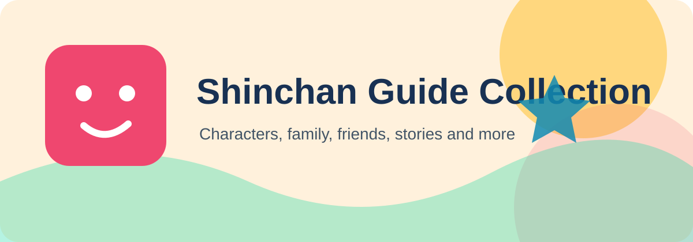

# Shinchan Manga and Anime

Shinchan began as a manga created by Yoshito Usui and became widely known through its animated adaptation. Both formats follow the Nohara family and their humorous everyday adventures.

| Format | What to expect |
|---|---|
| Manga | Illustrated stories presented in comic form |
| Television anime | Animated episodes featuring the characters and their routines |
| Films | Longer adventures built around a larger story |
| Local versions | Dubs and translations adapted for different audiences |

## Different ways to enjoy the series

The manga and screen adaptations share the core characters while presenting the stories in formats suited to reading or watching.
